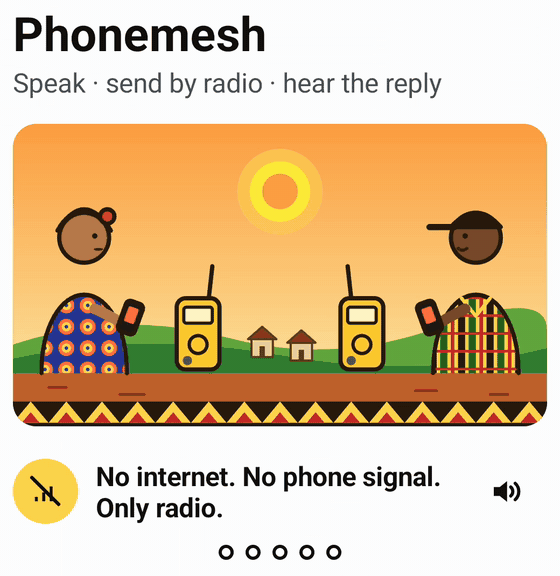
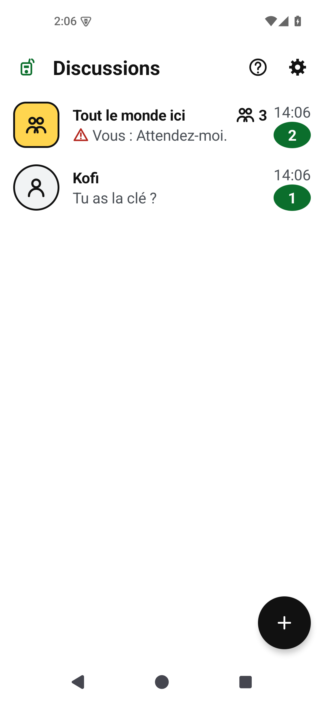
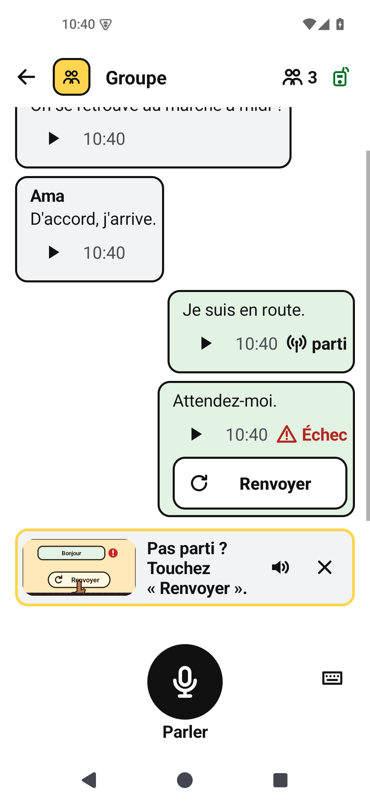
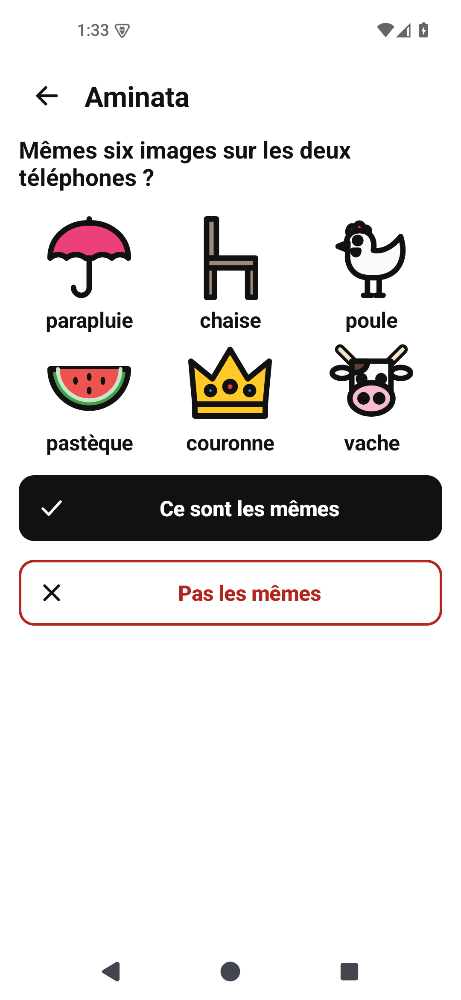
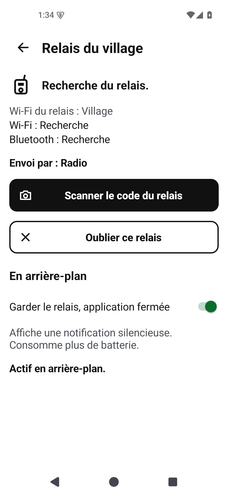

# Phonemesh

Voice messages over LoRa radio, for places without mobile coverage or internet.

You speak into your phone. Phonemesh turns the speech into text on the phone, sends the
words over a [Meshtastic](https://meshtastic.org) radio mesh, and the other phone reads
them aloud. **Audio never crosses the radio**: a LoRa packet carries about 230 bytes,
enough for a spoken sentence as text but nowhere near enough for the sound itself.

It is for anyone who needs to keep in touch where phones have no signal, and it is
meant to work on low-end Android phones. Everyday use does not depend on reading, so
people who read little or not at all are included too: you hear your message before you
send it, setup is a picture guide, and you check a contact by comparing six pictures
instead of a long number. The app is in French and English.

<p align="center">
  <picture>
    <source media="(prefers-color-scheme: dark)" srcset="docs/media/welcome-story-dark.gif">
    
  </picture>
</p>
<p align="center"><sub>The app's first screen explains Phonemesh in five steps.</sub></p>

<p align="center">
  
  
  
  
</p>
<p align="center"><sub>The chats list, the shared chat, comparing safety pictures, and the hub screen
(French interface; the app is also in English).</sub></p>

## Status

**v0.1.1, released 2026-10-27.** Download the APK for your phone from the
[v0.1.1 release](https://github.com/Tranquil-Flow/phonemesh/releases/tag/v0.1.1) and check
its SHA-256 against `SHA256SUMS` there. The [release notes](docs/releases/v0.1.1.md) say
what is new, what was tested and what was not.

v0.1.1 adds your own picture (a colour, an emoji, a letter or a small photo), the radio
time a message will take, a recovery kit for your contacts, any emoji as a reaction, and
fewer resends on a busy radio. It was checked on an emulator; v0.1.0 was tested on two
phones and a small number of radios. It is not a finished product and makes no range,
capacity or delivery guarantee.

**Try it without a radio.** Phonemesh Demo is the real app with a pretend radio, pretend
people and a pretend local hub. It runs on an Android phone, or in an emulator on a Mac.
Downloads and step-by-step instructions are on the
[v0.1.1 release](https://github.com/Tranquil-Flow/phonemesh/releases/tag/v0.1.1).

## How it works


- **Speech stays on the phone.** Whisper turns speech into text and Piper reads text
  aloud, both running locally from downloadable speech packs. There is no cloud speech,
  no translation and no voice cloning.
- **Accounts live on the phone**, not on the radio. Radios are shared equipment. You add
  people by scanning each other's QR code or by sending a link, then compare safety
  pictures to be sure you have the right person.
- **Private messages use Signal's design** (X3DH and the Double Ratchet), trimmed to fit
  LoRa: 25 bytes of overhead per packet. Someone listening on the radio sees that a
  packet was sent, when, how big it was and which radio sent it, but not who it is from,
  who it is for, or what it says.
- **Each message status means one thing.** *Sent* means a radio took it, *Reached the
  hub* means a local hub stored it, and only the recipient's own encrypted receipt shows
  *Delivered*.

## How accounts work

Your account is made on your phone the first time you open the app: you say your name
and pick a colour and a picture. There is no phone number, no email, no password and no account server.
Your encryption keys are created on the phone and never leave it.

Your account is not tied to a radio. Radios are shared equipment: you can use any radio,
or a local hub, and your contacts still reach you, because messages are addressed to
your account, not to a radio.

There is no search and no directory. You add someone in one of two ways:

| | In person | At a distance |
|---|---|---|
| How | Both phones open **Add someone** and scan each other's QR code | You send your link over a channel you trust (a message app, for example); they open it, and you **Accept** |
| Trust | Marked *met in person* | Marked *not met in person* until you compare safety pictures |

**Safety pictures** are six pictures computed from both of your keys. If they match on
both phones, nobody is in the middle pretending to be the other person. Compare them side
by side, or over a phone call for a contact added by link. No reading is needed.

**Settings → Recovery kit** makes a recovery card (a QR code and twelve words) and a sealed
copy of your contacts, or of your contacts and chosen chats. On a new phone the kit lists
your people again, and you add each one again: a new phone has a new account, so your
safety pictures change. Saved chats, private groups included, come back as read-only
history marked "from this saved copy", apart from your live chats: they never send,
speak or notify, and they hold no keys. Without a kit, a lost phone means a new account
that your contacts add again. The [explainer](docs/how-it-works.md#accounts-and-contacts)
covers keys and encryption.

## The local hub

A local hub is an optional station that stays on in a place where several people use
Phonemesh. It is a computer (a Mac in this first version) with a Meshtastic radio on USB,
set up by someone on site. Phones connect to it over its Wi-Fi or Bluetooth.

**When a hub is useful:**

- **Not everyone has a radio.** A radio costs money and serves one phone at a time. With
  a hub, many phones without a radio share the hub's radio. A clinic, school, market,
  farm, camp or shelter can run one hub instead of handing out a radio per person.
- **People come and go.** A phone that was switched off, or carried out of range, misses
  messages sent while it was away. The hub stays on and keeps every message it hears for
  30 days by default; the phone collects its messages the next time it connects.
- **A message was missed.** If the recipient's radio missed the broadcast, the sender's
  phone retries, and the hub sends the same message again.
- **A fixed, always-on radio.** The hub's radio can stay in one place on mains power, for
  example high up in a central building, instead of moving around with a person.

**When you do not need one:** people who each have a radio and are in range of each
other talk directly. A hub also does not extend reach past what radios can hear, does not
connect to the internet, and you cannot post to the shared chat through it (that needs
your own radio).


The hub cannot read private messages: they are encrypted from phone to phone, and the hub
only stores and forwards the encrypted packets. You add a hub by scanning the hub code its
operator shows you; from then on your phone checks that it is talking to that hub and no
other.

The app calls the hub's screen **Local hub** (*Relais local* in French). In v0.1.0 it was
**Village hub** (*Relais du village*).

The full explanation, including retries and how a phone connects, is in
**[How Phonemesh works](docs/how-it-works.md)**.

## What you need

- An Android phone, Android 8.0 or later, with an arm64-v8a or armeabi-v7a processor
  (almost every Android phone). Joining a hub's Wi-Fi needs Android 10.
- A way onto the mesh, either of:
  - a Meshtastic radio with Bluetooth near you (one phone uses a radio at a time), or
  - a local hub that you have scanned into the app.
- Speech packs: downloaded once over the internet, or copied from a friend's phone.

Tested on a Fairphone 3 (Android 10) and a Pixel 8 Pro (Android 16) with Meshtastic
firmware 2.7.26. That is what was checked, not a list of everything that works.

## Try it without a radio

**Phonemesh Demo** is the app with a pretend radio, pretend people and a pretend local hub
built in, so you can try every screen without hardware. Install it on an Android phone
next to the normal app, or run it on a laptop with the launcher in
[`demo/laptop`](demo/laptop/README.md). See [the demo guide](docs/demo.md).

## Setting up

### 1. Prepare the radios (once per radio)

Phonemesh works with radios running stock [Meshtastic](https://meshtastic.org) firmware
(tested with 2.7.26); it does not flash or replace firmware.

- **Same settings everywhere.** Radios hear each other only if they share the same LoRa
  region and modem preset and the same **primary channel** (name and key). Phonemesh
  sends everything on the primary channel. Radios left on Meshtastic's defaults (the
  LongFast preset and the default channel) match once their region is set.
- **Region.** A new radio has no region and stays silent until one is set. When you
  connect it, Phonemesh guesses your country, shows its flag, and sets the matching
  region after you confirm. If your country is not in its list, someone who has checked
  the local radio rules can choose the region instead. Phonemesh never changes the
  region without asking.
- **Channel key.** The primary channel's key protects the shared chat. On Meshtastic's
  default channel the key is public, so anyone with a Meshtastic radio can read the
  shared chat. For a private shared chat, set your own primary channel key on every radio
  with the stock Meshtastic app. Private chats are end-to-end encrypted either way.
  Phonemesh never changes channels or keys.
- **One app per radio.** Close or disconnect the stock Meshtastic app before connecting
  Phonemesh: only one app can hold a radio's Bluetooth connection.

### 2. Set up the app

Install the APK from the [release page](https://github.com/Tranquil-Flow/phonemesh/releases/tag/v0.1.1)
(allow installs from that source only if you trust it, and check the SHA-256). Choose
the app language on the first screen. A numbered guide then walks you through five steps,
each with pictures and spoken help:

| Step | What you do |
|---|---|
| 1. Download the voice | Download the speech engine and a voice once (an internet connection is needed for this step only). Or get them **From a friend**: on their phone, **Settings → Share the app** sends the app and packs through Android's share sheet. |
| 2. Say your name | Say your name (correct the text if needed) and pick your colour. This creates your account. |
| 3. Connect the radio | Turn the radio on, keep it close, and tap **Find radio**. Allow Bluetooth when asked (older Android versions also ask for location). Android may ask for the radio's pairing code: it is on the radio's screen, or the fixed PIN set in the radio. Then confirm the region. No radio? Scan a local hub's code in Settings instead. |
| 4. Add someone | Scan each other's code, or send your link (see [How accounts work](#how-accounts-work)). |
| 5. Say hello | Hold the microphone and say something to the shared chat. |

**Settings → Show the guide again** replays the welcome story and the tips at any time.

### 3. Optional: set up a local hub

One person sets up the hub: a Mac with a Meshtastic radio on USB, on the same region and
primary channel as everyone else's radios. They show each phone the hub's code to scan.
See [Run a local hub](#run-a-local-hub).

## What you can do

### Chats

- **Private chats** with each person you have added. They are end-to-end encrypted, and
  you see when a message reached the hub and when it was delivered.
- **One shared chat** for everyone on your radio channel, named after the channel. Use it
  for announcements. It is only as private as the channel key, and names in it are not
  proven. Posting to it needs your own radio.
- **The chats list** keeps the shared chat at the top. Long-press a private chat to
  **Pin to top** or **Delete chat**.
- **Private group chats** (a group of chosen people, encrypted for them only) are not
  in v0.1.1. They are planned for v0.1.2.

### Talking and listening

- **Talk:** hold the microphone button and release, or tap it to record hands-free and
  tap Stop. Slide up to lock, slide left to cancel. A recording lasts up to 15 seconds.
- **Check before sending:** your words appear as a draft. **Listen** reads them back;
  edit them, clear them, or record again. **Send** sends them.
- **Type instead:** the keyboard button lets you write a message.
- **Hear messages:** tap the play button on any message. **Settings → Read new messages
  aloud** reads new messages as they arrive while the app is open (off by default,
  because phones are often used in public).

### In a conversation

- **Reply** or **React** with any emoji by long-pressing a message that went over the radio.
- **Copy**, **Share** or **Forward** a message's words. Forwarding puts them in another
  chat's draft, so you hear them and choose to send.
- **Delete** a message from this phone (others keep their copy).
- **Radio time:** under the draft, the app says how long the radio will send it, for
  example "About 7 seconds on the radio".
- **Send a picture:** take or choose a photo, pick its size and colour, and see roughly
  how many seconds of radio time it will take before sending. Pictures travel in several
  packets and show their progress.
- **Send later:** tap **Later** under a draft, choose a day and time, and the phone sends
  it then (the radio must be in Bluetooth range at that time).
- **Resend:** a message that failed or was not confirmed shows a **Resend** button.

### Settings

- **Language:** the app's language (French or English).
- **Appearance:** auto, light or dark.
- **Languages (packs):** add or remove speech packs.
- **Understanding speech:** *Fast* (best for older phones) or *Accurate* (fewer
  mistakes, slower and a bigger download).
- **My name:** change your name, your colour and your picture (letter, emoji or photo).
- **Show my code:** your QR code and link for adding someone.
- **Local hub** (**Village hub** in v0.1.0): scan or forget a hub, see how messages are
  sent, and **Keep hub when app is closed**.
- **Read new messages aloud:** off by default.
- **Share the app:** send the app and speech packs to another phone.
- **Recovery kit:** make a recovery card and a sealed copy of your contacts, or of your
  contacts and chats (the last 90 days or all history, counted and sized before saving,
  checked after saving), restore one, or check one. **Saved chats** lists restored copies.
- **Show the guide again:** replay the welcome story and the tips.

The **?** button on the chats screen opens Help, which explains each feature with
pictures.

## Known limitations

- **TalkBack is not supported yet.** With TalkBack on, recording can pick up TalkBack's
  own speech and the send status is not announced. Phonemesh's own Listen and Read aloud
  are the supported voice path.
- **Hub Wi-Fi must be WPA2-Personal** (or open). Android 10 phones cannot join a
  WPA2/WPA3 mixed-mode network through the app.
- **Recovery keeps your contacts and saved chats, not your account.** A new phone has a new
  account; the recovery kit lists your people so you can add each one again. Restored chats
  are read-only history: you cannot reply in them, and a copy is a picture of one moment.
- **Photos need a local hub.** Your photo goes only through a local hub, never by radio.
  Contacts who never use that hub see your emoji or letter.
- History is stored in the app's private storage under Android's file encryption, not in
  a separately encrypted database.
- No quantum-safe encryption yet. Every message carries a key-type marker so it can be
  added without stranding older phones.
- The hub is a prototype that runs on a Mac. It has no power-cut safety and no
  exactly-once delivery guarantee.

## Coming next

Planned for v0.1.2, each with its own specification:

- **Private group chats:** a group of chosen contacts, encrypted for them only.
- **Encrypted chat backup**, for a lost or new phone.
- **Updates passed on through the local hub**, signed, for places without internet.

Then **Ewe and Kabiyè**, for the pilot in Togo.

Planned for later: TalkBack support and quantum-safe keys.

## Run a local hub

The hub is a Kotlin/JVM program driving a Meshtastic radio on USB. It runs on macOS,
Linux (including a Raspberry Pi) and Windows with Java 17. Phones reach it through its
Wi-Fi network, or on a Mac or Linux also through a small Bluetooth bridge. Setup,
configuration and enrolment are in the [hub guide](android/hub/README.md); the Bluetooth
bridges are in [hub-ble-bridge](hub-ble-bridge/README.md) (Mac) and
[hub-ble-bridge-linux](hub-ble-bridge-linux/README.md) (Linux).

## Build Android from source

Install **JDK 17**, Python 3, Android SDK platform **35** and build-tools, NDK
**28.2.13676358**, and CMake **3.22.1**. Set `JAVA_HOME` to your JDK 17 installation and
`ANDROID_HOME` to your Android SDK (or set `sdk.dir` in your untracked
`android/local.properties`). The Gradle wrapper is included.

From the repository root:

```sh
export JAVA_HOME="/absolute/path/to/jdk-17"
export ANDROID_HOME="/absolute/path/to/android-sdk"
python3 android/scripts/fetch-runtime.py
cd android
./gradlew --no-daemon --console plain :app:assembleRelease
./gradlew --no-daemon --console plain :core:test :hub:test \
  :app:checkApkSize :app:checkNetworkBoundary
```

`fetch-runtime.py` downloads the pinned sherpa-onnx **1.13.8** AAR into `android/libs/`
and checks its size and SHA-256. Speech packs are separate from the APK and are not
needed to compile; their catalog and provenance are in the
[Android design](docs/android-design.md#model-packs-and-multilingual-behavior).

Release APKs land in `android/app/build/outputs/apk/release/`, **unsigned**: the build
has no signing configuration. For a phone debug build, run `:app:assembleDebug` with
`-Pphonemesh.packBaseUrl=https://github.com/Tranquil-Flow/phonemesh-packs/releases/download/packs-1/`;
otherwise debug pack downloads point at an emulator-only local server. Debug builds
accept unknown packs; release builds accept only the built-in catalog.

The full project check is `scripts/check.sh` (Python, hub JVM and Android). Run the
[Swift bridge checks](hub-ble-bridge/README.md#build-and-test) separately.

## Repository layout

| Path | What it is |
|---|---|
| `android/app` | The Android app: screens, voice, chats, hub link |
| `android/core` | Accounts, encryption, sessions, wire formats, the hub client, and app rules (setup, recording, pictures) |
| `android/radio-ble` | Bluetooth connection to Meshtastic radios |
| `android/mesh-protocol` | Meshtastic protocol definitions |
| `android/hub` | The local hub (Kotlin/JVM) |
| `hub-ble-bridge` | Mac Bluetooth bridge between phones and the hub (Swift) |
| `src/phonemesh`, `tests` | The earlier laptop CLI ([legacy Python CLI](docs/python-cli.md)) |
| `docs` | Explainer, design, specs, verification records, licences |

## Documentation

- [How Phonemesh works](docs/how-it-works.md): the explainer.
- [Phonemesh Demo](docs/demo.md): try the app without a radio, and
  [what the demo covers](docs/demo-coverage.md).
- [Release notes for v0.1.1](docs/releases/v0.1.1.md) (and [v0.1.0](docs/releases/v0.1.0.md)) and the
  [verification record](docs/android-verification.md).
- [Android design](docs/android-design.md) and the
  [accounts and hub specification](docs/specs/2026-10-14-accounts-design.md).
- [Hub guide](android/hub/README.md) and [Bluetooth bridge](hub-ble-bridge/README.md).
- [Dependencies and licences](docs/dependencies.md).

## Licence

Licensed under the [GNU Affero General Public License v3.0](LICENSE). Third-party
components and models keep their own licences; see the
[dependency notes](docs/dependencies.md), [docs/licenses](docs/licenses/), and each speech
pack's `NOTICE.txt` and `SOURCES.json`. The optional picture-upscaling weights are not
distributed.
