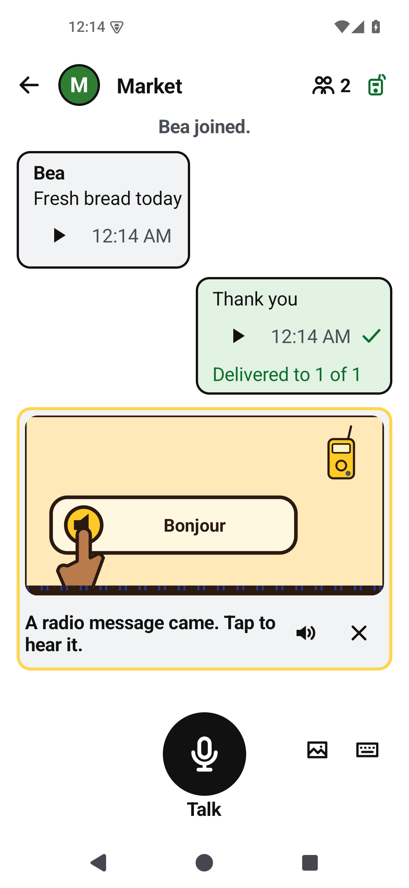
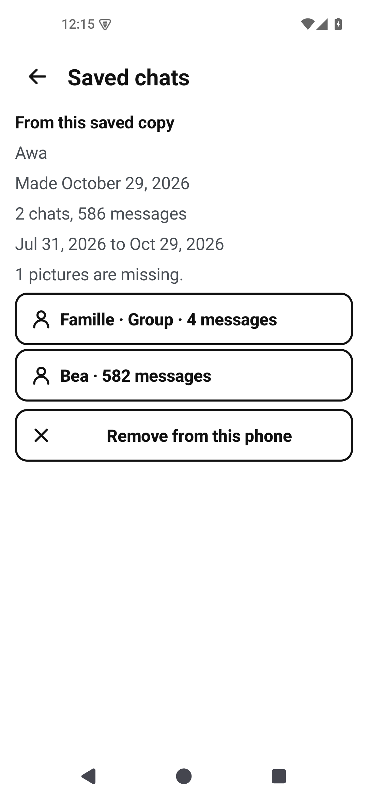
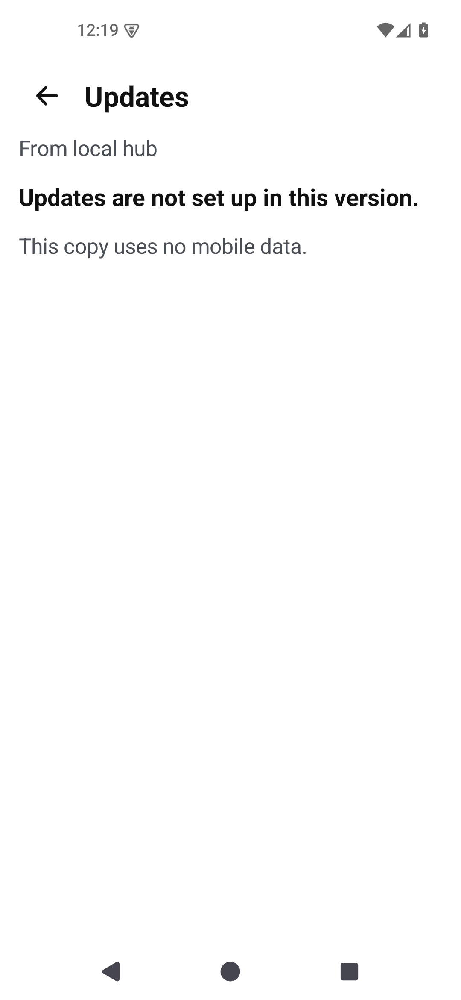
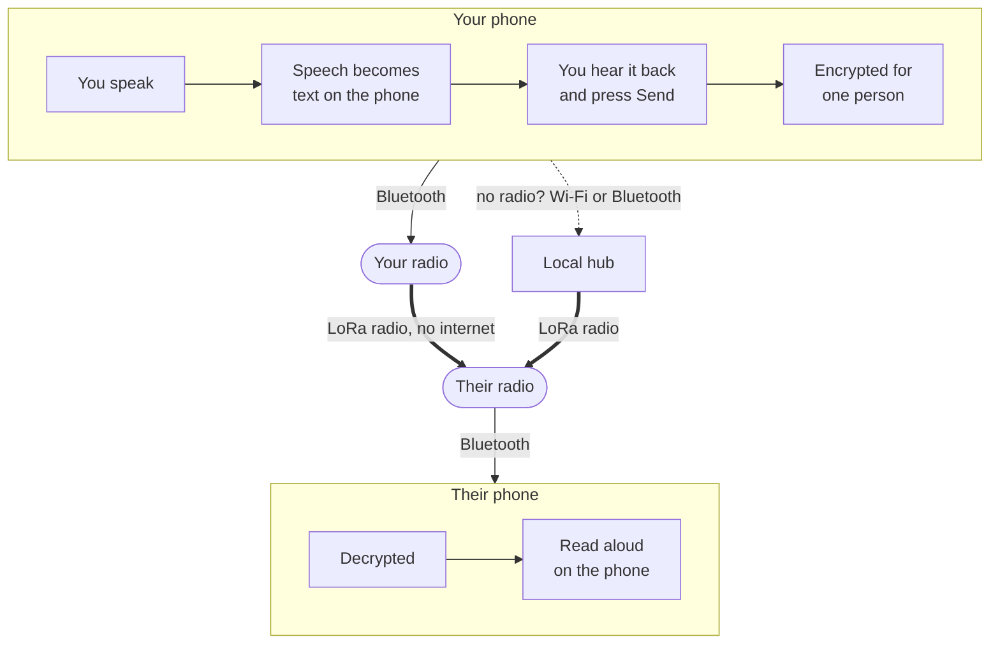
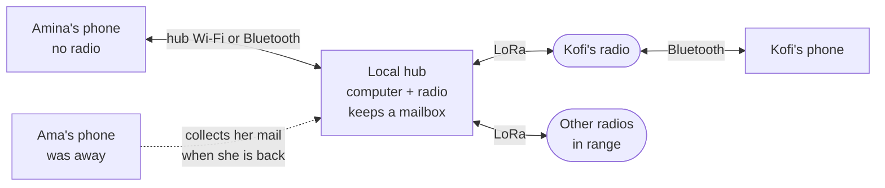

# Phonemesh

Voice messages over LoRa radio, for places without mobile coverage or internet.

You speak into your phone. Phonemesh turns the speech into text on the phone, sends the
words over a [Meshtastic](https://meshtastic.org) radio mesh, and the other phone reads
them aloud. **Audio never crosses the radio**: a LoRa packet carries about 230 bytes,
enough for a spoken sentence as text but nowhere near enough for the sound itself.

It is for anyone who needs to keep in touch where phones have no signal, and it is
meant to work on low-end Android phones. Everyday use does not depend on reading, so
people who read little or not at all are included too: you hear your message before you
send it, setup is a picture guide, and you check a contact by comparing six pictures
instead of a long number. The app is in French and English.

<p align="center">
  <picture>
    <source media="(prefers-color-scheme: dark)" srcset="docs/media/welcome-story-dark.gif">
    
  </picture>
</p>
<p align="center"><sub>The app's first screen explains Phonemesh in five steps.</sub></p>

<p align="center">
  
  
  
  
</p>
<p align="center"><sub>The chats list, the shared chat, comparing safety pictures, and the hub screen
(French interface; the app is also in English).</sub></p>

## Status

**Latest release: v0.1.1, released 2026-10-27.** Download the APK for your phone from the
[v0.1.1 release](https://github.com/Tranquil-Flow/phonemesh/releases/tag/v0.1.1) and check
its SHA-256 against `SHA256SUMS` there. The [release notes](docs/releases/v0.1.1.md) say
what is new, what was tested and what was not.

v0.1.1 adds your own picture (a colour, an emoji, a letter or a small photo), the radio
time a message will take, a recovery kit for your contacts, any emoji as a reaction, and
fewer resends on a busy radio. It was checked on an emulator; v0.1.0 was tested on two
phones and a small number of radios. It is not a finished product and makes no range,
capacity or delivery guarantee.

**The v0.1.2 production release is not signed or published.** The `v0.1.2` branch adds
[private group chats](#private-groups), [saved chats](#saving-your-chats) and hub speech-pack updates.
Release builds currently refuse the TEST update keys, so their Updates screen says
"Updates are not set up in this version." The [candidate notes](docs/releases/v0.1.2.md)
separate completed checks from owner signing and physical tests that remain.

**Try the v0.1.2 demo without a radio.** Download the laptop ZIP from the
[demo pre-release](https://github.com/Tranquil-Flow/phonemesh/releases/tag/v0.1.2-demo.1),
unzip it and open **Start Phonemesh Demo.command** on a Mac. The ZIP carries its own demo
APKs, including private groups and simulated hub pack updates; a bare launcher without those
files still fetches the latest stable v0.1.1 demo. The [demo guide](docs/demo.md) has the steps
and tested limits. Typing does not need a microphone. The release page also has a block to paste
into an agent on your own computer, which sets the demo up for you; it starts without a
microphone or sound and pins the ZIP's SHA-256.

<p align="center">
  <picture><source media="(prefers-color-scheme: dark)" srcset="docs/screenshots-v012/group-dark.png"></picture>
  <picture><source media="(prefers-color-scheme: dark)" srcset="docs/screenshots-v012/saved-chats-dark.png"></picture>
  <picture><source media="(prefers-color-scheme: dark)" srcset="docs/screenshots-v012/updates-off-dark.png"></picture>
</p>
<p align="center"><sub>v0.1.2 emulator fixtures, in light and dark themes. The production update-key gate stays closed.</sub></p>

## How it works



- **Speech stays on the phone.** Whisper turns speech into text and Piper reads text
  aloud, both running locally from downloadable speech packs. There is no cloud speech,
  no translation and no voice cloning.
- **Accounts live on the phone**, not on the radio. Radios are shared equipment. You add
  people by scanning each other's QR code or by sending a link, then compare safety
  pictures to be sure you have the right person.
- **Private messages use Signal's design** (X3DH and the Double Ratchet), trimmed to fit
  LoRa: 25 bytes of overhead per packet. Someone listening on the radio sees that a
  packet was sent, when, how big it was and which radio sent it, but not who it is from,
  who it is for, or what it says.
- **Each message status means one thing.** *Sent* means a radio took it, *Reached the
  hub* means a local hub stored it, and only the recipient's own encrypted receipt shows
  *Delivered*.

## How accounts work

Your account is made on your phone the first time you open the app: you say your name
and pick a colour and a picture. There is no phone number, no email, no password and no account server.
Your encryption keys are created on the phone and never leave it.

Your account is not tied to a radio. Radios are shared equipment: you can use any radio,
or a local hub, and your contacts still reach you, because messages are addressed to
your account, not to a radio.

There is no search and no directory. You add someone in one of two ways:

| | In person | At a distance |
|---|---|---|
| How | Both phones open **Add someone** and scan each other's QR code | You send your link over a channel you trust (a message app, for example); they open it, and you **Accept** |
| Trust | Marked *met in person* | Marked *not met in person* until you compare safety pictures |

**Safety pictures** are six pictures computed from both of your keys. If they match on
both phones, nobody is in the middle pretending to be the other person. Compare them side
by side, or over a phone call for a contact added by link. No reading is needed.

**Settings → Recovery kit** makes a recovery card (a QR code and twelve words) and a sealed
copy of your contacts. On a new phone the kit lists your people again, and you add each
one again: a new phone has a new account, so your safety pictures change. Without a kit,
a lost phone means a new account that your contacts add again. In the v0.1.2 candidate the
kit can also [save your chats](#saving-your-chats). The
[explainer](docs/how-it-works.md#accounts-and-contacts) covers keys and encryption.

### Saving your chats

*New in the v0.1.2 candidate. v0.1.1 saves contacts only.*

**Settings → Recovery kit** now asks what to keep: **Contacts only** or **Contacts and chats**.
Choose chats when you want your history to survive a lost or broken phone. Contacts only is
enough when all you need back is your list of people.

1. **Choose the chats** to save. Private chats, private groups, the shared chat and old radio
   chats are listed and labelled. Then pick **Last 90 days** or **All history**, and say whether
   to include pictures and messages that were not sent or not confirmed.
2. **Count and size** shows how many chats, messages and pictures the copy will hold, and how
   big the file will be, before anything is written. It also says what is left out.
3. Switch on **I wrote the card down**, then save the file in a place you choose with Android's
   file picker. The app reads the file back and says **Saved**. **Check it now** opens the file
   with your card, to prove the two match.

On a new phone, restoring the kit puts the chats in **Saved chats**, apart from your live
chats. Each one is marked "From this saved copy" and is read only: it never sends, speaks or
notifies, and you cannot reply in it. The copy holds no live secret keys, so a saved private group is
history only. Your phone is not back in the group, and an admin has to add you again. A
phone keeps at most eight saved copies, and **Remove from this phone** deletes one (the file
you saved stays where you put it).

The card opens the file, and the phone never stores the card. Anyone who has both the file
and the card can read the chats, so keep them in different places. A copy walks the selected
rows rather than freezing the whole phone at one instant: a message deleted while the copy
was being made may be missing, and messages
longer than 4,096 bytes are shortened and counted. The
[backup specification](docs/specs/2026-10-26-encrypted-chat-backup-design.md) lists the other
limits.

Example: Amina saves a **Contacts and chats** copy to a memory card and keeps the card's
paper at home. Her phone is stolen. On a new phone she restores the kit, adds Kofi again by
scanning his code, and finds her old chat with him under **Saved chats**, with the Market
group that Kofi runs. Kofi has to add her to Market again.

## Private groups

*New in the v0.1.2 candidate. v0.1.1 has the shared chat and one-to-one chats only.*

A private group is a chat for up to 20 people that you choose, yourself included. The shared
chat is open to everyone on your radio channel and is only as private as the channel key. A
private group is encrypted for its members, the way a private chat is for two.

**When a group is useful:** a family, a clinic team or a row of market stalls wants one thread
that only its members can read. **When you do not need one:** two people can use a private
chat, and an announcement for everyone nearby belongs in the shared chat.

**Starting one.** In **Add someone**, tap **New private group** and choose people you have
already added ("Only people you added can join."). Then say or type a short name, pick a
colour and a letter, emoji or photo, and tap **Create group**. Each person gets a card that
says "&lt;name&gt; added you to &lt;group&gt;" with **Join** and **Ignore**. Nobody is in a group
without tapping **Join**, and joining shows your own name and picture to the other members.

**Admins.** The person who makes a group is its admin. Admins can add people, make another
member an admin, remove people, change the name and picture, and switch on **New members
see recent messages**. Open **Group details** by tapping the group's title. The last admin
to leave chooses who becomes admin next.

**Keys, in short.** The group has one secret key. Whenever someone joins, leaves or is
removed, an admin makes a new key and sends it to each member through that member's private
chat session, together with the new member list. Messages are encrypted with the key and
signed by their sender's own key for that group. Several joins and leaves within about a
minute share one change.

**Who must know whom.** Keys travel through private chat sessions, so an admin can change a
group only while every other member is that admin's contact. Otherwise the app says "Add
&lt;name&gt; to your contacts first." Ordinary members do not need to know each other: someone you
have not added shows under the name they chose, with "Not in your contacts", and
**Add to my contacts** is in Group details.

**Sending.** Group messages go out like your other messages, over your radio; a phone on a
hub's Wi-Fi gives them to the hub first. Your messages show **Delivered to 2 of 3**: how many
of the other members, counted when you sent it, have sent back a receipt.

**Pictures and recent messages.** A full picture, a member's photo and the group photo go
only through a local hub, never by radio. Members who do not use that hub see a colour sketch
("Others see a sketch"), one radio packet. With **New members see recent messages** on (it
starts off), an admin who adds people shares the last 7 days of messages, at most 50, through a
hub only. New members see them marked "Shared by &lt;admin&gt;". Without that switch a new member
sees nothing from before: "You joined. Earlier messages are not shown."

**Leaving and removing.** **Leave group** asks first; messages already sent may still arrive.
Someone who is removed keeps the messages they already have.

**Group code.** Group details shows four pictures worked out from the member list. Compare
them to look for different lists. They are a short check of the list, not proof that its
key bindings are honest. Each member's signing key is bound to them by the admin, and the app trusts that
binding even when the codes match.

**What others can see.** Someone listening on the radio sees that a packet was sent, when,
how big it was and which radio sent it. Nothing on the air names the group or the sender. A
hub stores and passes on group packets without being able to read them.

**What you are trusting.**

- Members. Anyone in a group can copy, screenshot or forward what they read. A member with a
  modified app could also read the recent messages meant for a later joiner.
- Admins. They hold the member list. An admin who lies about it could make a message look as
  if another member wrote it, for the others. Comparing group codes can reveal different
  lists. It cannot show that an admin bound each person's signing key honestly: that
  binding is trusted even when the codes match.
- Counts and names. "Delivered to N of M" counts what members' phones report, and the author
  and time on a "Shared by" message are the admin's word.
- Reviewers. AI agents reviewed the group code and every finding was fixed. No human
  cryptographer has reviewed it.

Example: Kofi makes **Market** with Amina and Yaw. Amina and Yaw have never met, so each sees
the other marked "Not in your contacts". Kofi writes "Who brings bread?" and sees
"Delivered to 1 of 2" until Yaw's phone, which was off, comes back and sends its receipt.
Later Kofi adds Ama. While the new key has not reached Amina's phone, it says "Group change
on its way. Sending paused." and offers **Ask Kofi again**.

## The local hub

A local hub is an optional station that stays on in a place where several people use
Phonemesh. It is a computer (a Mac in this first version) with a Meshtastic radio on USB,
set up by someone on site. Phones connect to it over its Wi-Fi or Bluetooth.

**When a hub is useful:**

- **Not everyone has a radio.** A radio costs money and serves one phone at a time. With
  a hub, many phones without a radio share the hub's radio. A clinic, school, market,
  farm, camp or shelter can run one hub instead of handing out a radio per person.
- **People come and go.** A phone that was switched off, or carried out of range, misses
  messages sent while it was away. The hub stays on and keeps every message it hears for
  30 days by default; the phone collects its messages the next time it connects.
- **A message was missed.** If the recipient's radio missed the broadcast, the sender's
  phone retries, and the hub sends the same message again.
- **A fixed, always-on radio.** The hub's radio can stay in one place on mains power, for
  example high up in a central building, instead of moving around with a person.
- **Pictures in groups** (v0.1.2). Full group pictures, group photos and recent messages for
  new group members go only through a hub, so a hub is the way they travel.
- **Updates without internet** (v0.1.2). The hub's operator can bring signed speech-pack
  updates on a stick. Phones copy them over the hub's Wi-Fi after you tap **Download**.

**When you do not need one:** people who each have a radio and are in range of each
other talk directly. A hub also does not extend reach past what radios can hear, does not
connect to the internet, and you cannot post to the shared chat through it (that needs
your own radio).



The hub cannot read private messages or, in v0.1.2, group messages: they are encrypted from
phone to phone, and the hub only stores and forwards the encrypted packets. You add a hub by scanning the hub code its
operator shows you; from then on your phone checks that it is talking to that hub and no
other.

The app calls the hub's screen **Local hub** (*Relais local* in French). In v0.1.0 it was
**Village hub** (*Relais du village*).

The full explanation, including retries and how a phone connects, is in
**[How Phonemesh works](docs/how-it-works.md)**.

## What you need

- An Android phone, Android 8.0 or later, with an arm64-v8a or armeabi-v7a processor
  (almost every Android phone). Joining a hub's Wi-Fi needs Android 10.
- A way onto the mesh, either of:
  - a Meshtastic radio with Bluetooth near you (one phone uses a radio at a time), or
  - a local hub that you have scanned into the app.
- Speech packs: downloaded once over the internet, or copied from a friend's phone.

Tested on a Fairphone 3 (Android 10) and a Pixel 8 Pro (Android 16) with Meshtastic
firmware 2.7.26. That is what was checked, not a list of everything that works.

## Try it without a radio

**Phonemesh Demo** is the app with a pretend radio, pretend people and a pretend local hub
built in, so you can try every screen without hardware. Install it on an Android phone
next to the normal app, or run it on a laptop with the launcher in
[`demo/laptop`](demo/laptop/README.md). See [the demo guide](docs/demo.md).

## Setting up

### 1. Prepare the radios (once per radio)

Phonemesh works with radios running stock [Meshtastic](https://meshtastic.org) firmware
(tested with 2.7.26); it does not flash or replace firmware.

- **Same settings everywhere.** Radios hear each other only if they share the same LoRa
  region and modem preset and the same **primary channel** (name and key). Phonemesh
  sends everything on the primary channel. Radios left on Meshtastic's defaults (the
  LongFast preset and the default channel) match once their region is set.
- **Region.** A new radio has no region and stays silent until one is set. When you
  connect it, Phonemesh guesses your country, shows its flag, and sets the matching
  region after you confirm. If your country is not in its list, someone who has checked
  the local radio rules can choose the region instead. Phonemesh never changes the
  region without asking.
- **Channel key.** The primary channel's key protects the shared chat. On Meshtastic's
  default channel the key is public, so anyone with a Meshtastic radio can read the
  shared chat. For a private shared chat, set your own primary channel key on every radio
  with the stock Meshtastic app. Private chats are end-to-end encrypted either way.
  Phonemesh never changes channels or keys.
- **One app per radio.** Close or disconnect the stock Meshtastic app before connecting
  Phonemesh: only one app can hold a radio's Bluetooth connection.

### 2. Set up the app

Install the APK from the [release page](https://github.com/Tranquil-Flow/phonemesh/releases/tag/v0.1.1)
(allow installs from that source only if you trust it, and check the SHA-256). Choose
the app language on the first screen. A numbered guide then walks you through five steps,
each with pictures and spoken help:

| Step | What you do |
|---|---|
| 1. Download the voice | Download the speech engine and a voice once (an internet connection is needed for this step only). Or get them **From a friend**: on their phone, **Settings → Share the app** sends the app and packs through Android's share sheet. |
| 2. Say your name | Say your name (correct the text if needed) and pick your colour. This creates your account. |
| 3. Connect the radio | Turn the radio on, keep it close, and tap **Find radio**. Allow Bluetooth when asked (older Android versions also ask for location). Android may ask for the radio's pairing code: it is on the radio's screen, or the fixed PIN set in the radio. Then confirm the region. No radio? Scan a local hub's code in Settings instead. |
| 4. Add someone | Scan each other's code, or send your link (see [How accounts work](#how-accounts-work)). |
| 5. Say hello | Hold the microphone and say something to the shared chat. |

**Settings → Show the guide again** replays the welcome story and the tips at any time.

### 3. Optional: set up a local hub

One person sets up the hub: a Mac with a Meshtastic radio on USB, on the same region and
primary channel as everyone else's radios. They show each phone the hub's code to scan.
See [Run a local hub](#run-a-local-hub).

## What you can do

### Chats

- **Private chats** with each person you have added. They are end-to-end encrypted, and
  you see when a message reached the hub and when it was delivered.
- **One shared chat** for everyone on your radio channel, named after the channel. Use it
  for announcements. It is only as private as the channel key, and names in it are not
  proven. Posting to it needs your own radio.
- **The chats list** keeps the shared chat at the top. Long-press a private chat to
  **Pin to top** or **Delete chat**.
- **Private group chats** (v0.1.2; not in v0.1.1): a group of up to 20 people you have added,
  encrypted for them only. Start one with **Add someone → New private group**, and answer an
  invitation on the chats list with **Join** or **Ignore**. See
  [Private groups](#private-groups).

### Talking and listening

- **Talk:** hold the microphone button and release, or tap it to record hands-free and
  tap Stop. Slide up to lock, slide left to cancel. A recording lasts up to 15 seconds.
- **Check before sending:** your words appear as a draft. **Listen** reads them back;
  edit them, clear them, or record again. **Send** sends them.
- **Type instead:** the keyboard button lets you write a message.
- **Hear messages:** tap the play button on any message. **Settings → Read new messages
  aloud** reads new messages as they arrive while the app is open (off by default,
  because phones are often used in public).

### In a conversation

- **Reply** or **React** with any emoji by long-pressing a message that went over the radio.
- **Copy**, **Share** or **Forward** a message's words. Forwarding puts them in another
  chat's draft, so you hear them and choose to send.
- **Delete** a message from this phone (others keep their copy).
- **Radio time:** under the draft, the app says how long the radio will send it, for
  example "About 7 seconds on the radio".
- **Send a picture:** take or choose a photo, pick its size and colour, and see roughly
  how many seconds of radio time it will take before sending. Pictures travel in several
  packets and show their progress.
- **Send later:** tap **Later** under a draft, choose a day and time, and the phone sends
  it then (the radio must be in Bluetooth range at that time).
- **Resend:** a message that failed or was not confirmed shows a **Resend** button.
- **In a private group** (v0.1.2): each message shows who wrote it, with their picture.
  Someone you have not added is marked **Not in your contacts**. Your messages show
  **Delivered to 2 of 3**. Reply, React and pictures work as in a private chat; members
  without the hub see a picture as a colour sketch. Tap the group's title for
  **Group details**:
  - **People in this group**, tagged **Admin**, **Not joined yet** or **Not in your
    contacts**. Tap a person for **Add to my contacts**, or, as an admin, **Make admin** and
    **Remove from group**.
  - For admins: **Name and picture**, **Add people** and **New members see recent messages**.
  - **Group code:** four pictures to compare with another member.
  - **Leave group:** the last admin chooses who becomes admin next.

### Settings

- **Language:** the app's language (French or English).
- **Appearance:** auto, light or dark.
- **Languages (packs):** add or remove speech packs.
- **Understanding speech:** *Fast* (best for older phones) or *Accurate* (fewer
  mistakes, slower and a bigger download).
- **My name:** change your name, your colour and your picture (letter, emoji or photo).
- **Show my code:** your QR code and link for adding someone.
- **Local hub** (**Village hub** in v0.1.0): scan or forget a hub, see how messages are
  sent, and **Keep hub when app is closed**.
  - **Updates** (v0.1.2): copies newer speech packs from the hub over its Wi-Fi, only after
    you tap **Download** (the button shows the size). It uses no mobile data. You can
    **Pause** and **Resume**. A new pack replaces the old one only after it checks out and
    opens; if anything fails the old pack stays. It needs the hub's Wi-Fi ("Join the hub
    Wi-Fi first.") and a hub whose operator has brought a signed release. A build without the
    project's real update keys says "Updates are not set up in this version." This branch
    carries only test keys so far, and release builds refuse those.
- **Read new messages aloud:** off by default.
- **Share the app:** send the app and speech packs to another phone.
- **Recovery kit:** make a recovery card and a sealed copy of your contacts, restore one, or
  check one. In v0.1.2 the copy can also hold your chats (**Contacts and chats**: the last 90
  days or all history, counted and sized before saving, read back after saving), and
  **Saved chats** lists restored copies. See [Saving your chats](#saving-your-chats).
- **Show the guide again:** replay the welcome story and the tips.

The **?** button on the chats screen opens Help, which explains each feature with
pictures.

## Known limitations

- **TalkBack is not supported yet.** With TalkBack on, recording can pick up TalkBack's
  own speech and the send status is not announced. Phonemesh's own Listen and Read aloud
  are the supported voice path.
- **Hub Wi-Fi must be WPA2-Personal** (or open). Android 10 phones cannot join a
  WPA2/WPA3 mixed-mode network through the app.
- **Recovery keeps your contacts, not your account.** A new phone has a new account; the
  recovery kit lists your people so you can add each one again. In v0.1.2 it can also keep
  chats: restored chats are read-only history, you cannot reply in them, a saved private
  group is history only (you are not back in the group), and a copy is a picture of one
  moment. A phone keeps at most eight saved copies.
- **Private groups (v0.1.2) hold 20 people at most.** An admin can change a group only while
  every other member is that admin's contact. A change reaches members with a new key, and
  several changes within about a minute share one. A phone still waiting for it says "Group
  change on its way. Sending paused." If two admins change a group at once, sending stops
  until an admin taps **Fix the group**.
- **Group counts and authors are claims.** "Delivered to N of M" counts what members' phones
  report, and the author and time on a "Shared by" message are the admin's word. Messages
  longer than about 126 bytes are not shared with new members.
- **Group pictures and photos need a local hub.** Members without it see a sketch or the
  member's emoji or letter. Recent messages for new members go only through a hub too.
- **The last admin of a two-person group cannot hand it over.** If that admin leaves, the
  other person keeps a group with no admin and nobody is told. Both people leaving is
  cleaner.
- **Hub updates cover speech packs, not the app.** They need the hub's Wi-Fi and a build
  that carries the project's real update keys. The app itself is still updated by installing
  a new APK.
- **Review.** The v0.1.2 group, backup and update code was reviewed by AI agents, and every
  finding was fixed. No human cryptographer has reviewed it.
- **Photos need a local hub.** Your photo goes only through a local hub, never by radio.
  Contacts who never use that hub see your emoji or letter.
- History is stored in the app's private storage under Android's file encryption, not in
  a separately encrypted database.
- No quantum-safe encryption yet. Every message carries a key-type marker so it can be
  added without stranding older phones.
- The hub is a prototype that runs on a Mac. It has no power-cut safety and no
  exactly-once delivery guarantee.

## Coming next

Private group chats, saved chats and signed speech-pack updates through the local hub were
the plan for v0.1.2, and the candidate on this branch contains all three. After v0.1.2:
**Ewe and Kabiyè**, for the pilot in Togo.

Planned for later: TalkBack support, quantum-safe keys, app updates through a hub (v0.1.2
passes on speech packs only), and the radio settings profile that cuts automatic
broadcasts.

## Run a local hub

The hub is a Kotlin/JVM program driving a Meshtastic radio on USB. It runs on macOS,
Linux (including a Raspberry Pi) and Windows with Java 17. Phones reach it through its
Wi-Fi network, or on a Mac or Linux also through a small Bluetooth bridge. Setup,
configuration and enrolment are in the [hub guide](android/hub/README.md); the Bluetooth
bridges are in [hub-ble-bridge](hub-ble-bridge/README.md) (Mac) and
[hub-ble-bridge-linux](hub-ble-bridge-linux/README.md) (Linux).

## Build Android from source

Install **JDK 17**, Python 3, Android SDK platform **35** and build-tools, NDK
**28.2.13676358**, and CMake **3.22.1**. Set `JAVA_HOME` to your JDK 17 installation and
`ANDROID_HOME` to your Android SDK (or set `sdk.dir` in your untracked
`android/local.properties`). The Gradle wrapper is included.

From the repository root:

```sh
export JAVA_HOME="/absolute/path/to/jdk-17"
export ANDROID_HOME="/absolute/path/to/android-sdk"
python3 android/scripts/fetch-runtime.py
cd android
./gradlew --no-daemon --console plain :app:assembleRelease
./gradlew --no-daemon --console plain :core:test :hub:test \
  :app:checkApkSize :app:checkNetworkBoundary
```

`fetch-runtime.py` downloads the pinned sherpa-onnx **1.13.8** AAR into `android/libs/`
and checks its size and SHA-256. Speech packs are separate from the APK and are not
needed to compile; their catalog and provenance are in the
[Android design](docs/android-design.md#model-packs-and-multilingual-behavior).

Release APKs land in `android/app/build/outputs/apk/release/`, **unsigned**: the build
has no signing configuration. For a phone debug build, run `:app:assembleDebug` with
`-Pphonemesh.packBaseUrl=https://github.com/Tranquil-Flow/phonemesh-packs/releases/download/packs-1/`;
otherwise debug pack downloads point at an emulator-only local server. Debug builds
accept unknown packs; release builds accept only the built-in catalog.

The full project check is `scripts/check.sh` (Python, hub JVM and Android). Run the
[Swift bridge checks](hub-ble-bridge/README.md#build-and-test) separately.

## Repository layout

| Path | What it is |
|---|---|
| `android/app` | The Android app: screens, voice, chats, hub link |
| `android/core` | Accounts, encryption, sessions, wire formats, the hub client, and app rules (setup, recording, pictures) |
| `android/radio-ble` | Bluetooth connection to Meshtastic radios |
| `android/mesh-protocol` | Meshtastic protocol definitions |
| `android/hub` | The local hub (Kotlin/JVM) |
| `hub-ble-bridge` | Mac Bluetooth bridge between phones and the hub (Swift) |
| `src/phonemesh`, `tests` | The earlier laptop CLI ([legacy Python CLI](docs/python-cli.md)) |
| `docs` | Explainer, design, specs, verification records, licences |

## Documentation

- [How Phonemesh works](docs/how-it-works.md): the explainer.
- [Phonemesh Demo](docs/demo.md): try the app without a radio, and
  [what the demo covers](docs/demo-coverage.md).
- [Release notes for v0.1.1](docs/releases/v0.1.1.md) (and [v0.1.0](docs/releases/v0.1.0.md)),
  the [draft notes for the unreleased v0.1.2](docs/releases/v0.1.2.md) and the
  [verification record](docs/android-verification.md).
- [Update signing keys](docs/update-keys.md): the owner's steps for hub updates.
- [Android design](docs/android-design.md) and the
  [accounts and hub specification](docs/specs/2026-10-14-accounts-design.md).
- [Hub guide](android/hub/README.md) and [Bluetooth bridge](hub-ble-bridge/README.md).
- [Dependencies and licences](docs/dependencies.md).

## Licence

Licensed under the [GNU Affero General Public License v3.0](LICENSE). Third-party
components and models keep their own licences; see the
[dependency notes](docs/dependencies.md), [docs/licenses](docs/licenses/), and each speech
pack's `NOTICE.txt` and `SOURCES.json`. The optional picture-upscaling weights are not
distributed.
