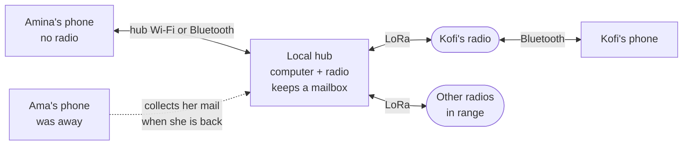

# How Phonemesh works

Phonemesh lets people send spoken messages to each other over LoRa radio, where there is
no mobile coverage or internet. This page explains the whole system: the voice path,
accounts, encryption, delivery, the local hub, and how a phone connects. The
[README](../README.md) has the short version and setup steps; the
[specifications](#further-reading) have every byte.

This page follows the v0.1.2 candidate. The production release is not signed; the
[demo pre-release](https://github.com/Tranquil-Flow/phonemesh/releases/tag/v0.1.2-demo.1)
can be tried now. v0.1.1 remains the latest stable release.

## Who it is for, and the main constraint

Phonemesh is for anyone who needs to message where there is no mobile signal or internet:
villages, remote areas, outages. It is designed to work on low-end Android phones, and
the app is in French and English.

It is also built so that everyday use does not depend on reading, which includes people
who read little or not at all. You speak instead of typing, you hear your message
before sending it, the setup guide is drawn, and you check a contact by comparing
pictures rather than reading a number. These features work the same for everyone who
would rather speak than type.

The radio sets the main constraint. Meshtastic radios use LoRa, a long-range but very
slow radio. One packet carries about 230 bytes, and in Europe each radio may transmit
only a small share of the time (a 10% duty cycle on 868 MHz). A few seconds of compressed
audio would take many packets. A spoken sentence written as text fits in one. So
Phonemesh sends the words, not the sound:

```
speak -> speech to text (on the phone) -> check and edit -> encrypt -> radio
radio -> decrypt -> text to speech (on the phone) -> listen
```

The listener hears a synthetic voice reading the sender's words, not the sender's own
voice.

## The pieces

| Piece | What it does |
|---|---|
| Phonemesh app (Android) | Records, transcribes, encrypts, sends, receives, reads aloud. Holds the account and history. |
| Meshtastic radio | A small LoRa radio (stock Meshtastic firmware). The phone talks to it over Bluetooth. Radios are shared equipment and hold no account. |
| Local hub (optional) | A computer with a Meshtastic radio on USB. Stores mail for phones that are out of range and sends packets for phones without a radio. |
| Hub Bluetooth bridge (optional) | A small Mac program that lets phones reach the hub over Bluetooth instead of Wi-Fi. |
| Speech packs | Separate downloads with the speech-recognition engine and the voices. |

## Sending a voice message

1. **Record.** Hold **Talk** and release, or tap to record hands-free and tap Stop. Slide
   up to lock, left to cancel. Recording stops at 15 seconds. The microphone is used only
   while you record.
2. **Transcribe.** [Whisper](https://github.com/openai/whisper) runs on the phone (the
   Tiny or Base engine, your choice) and writes what you said.
3. **Check.** The text appears as a draft. **Listen** reads it back with
   [Piper](https://github.com/rhasspy/piper), so someone who cannot read hears exactly
   what will be sent. You can re-record or edit. If the text is too long for one packet,
   the app cuts it and marks it for review.
4. **Send.** The words are encrypted for the recipient and go out through your radio or
   the hub. Nothing is sent until you press Send.
5. **Receive.** The recipient's phone decrypts the message and shows it. Tapping play
   reads it aloud. Reading new messages aloud automatically is an opt-in setting.

Both engines run through one local runtime (sherpa-onnx) on the phone's processor. There
is no cloud speech, no translation and no voice cloning.

Chats also support pictures (several packets each, shrunk to fit), replies, reactions,
forwarding and messages planned for later.

## Accounts and contacts

Your identity lives on your phone. When you first open the app you say your name (the
app writes it down and you can correct it) and pick a colour. Other phones read your name
aloud. Behind that, the app creates:

- an **identity key** (P-256) and a signed **prekey** used to start conversations;
- an **account id**: the first 8 bytes of a hash of the identity key.

On Android 12 and later the private keys are in the phone's hardware Keystore, where the
app itself cannot read them. On older versions they are software keys stored encrypted
under a Keystore key. Backup is off, so keys never leave the phone.

There is no username search and no list of accounts. You add people in one of two ways.

**QR code, in person.** Both phones show a contact card as a QR code
(identity key, prekey, signature and profile) and scan each other. The contact
is marked *met in person*.

**Link, at a distance.** **Send my link** shares
`https://tranquil-flow.github.io/phonemesh/add#<card>`. The card sits after the `#`, so
the website never receives it. Android opens the link straight in Phonemesh; without the
app, the page explains how to get it. The person who opens the link sends a small "hello"
over the radio (one packet that names neither person), and the link's owner hears
"*name* wants to talk to you" and accepts or ignores it. You can talk at once, but the
contact shows *not met in person* until you compare safety pictures.

**Safety pictures.** Each pair of contacts sees the same six pictures out of 64, computed
from both identity keys with a deliberately slow hash. You compare them in person or over
a channel you trust (a phone call, for example) and press *They are the same* or *Not the
same*. The card signature covers both keys and the whole profile (including name, colour
and picture choice); those are what the person chose, not proof of who they are. Comparing
safety pictures checks the identity keys through a channel you trust.

**Recovery kit.** Save a sealed copy of contacts, or (in v0.1.2) contacts and chosen chats,
with a separate twelve-word card. A restored phone still makes a new account; contacts
must add it again. Old chats are read-only history, not restored live sessions or group keys.
See [Saving your chats](#saving-your-chats).

## Saving your chats

*New in the v0.1.2 candidate. v0.1.1 saves contacts only.*

**Settings → Recovery kit** now asks what to keep: **Contacts only** or **Contacts and chats**.
Choose chats when you want your history to survive a lost or broken phone. Contacts only is
enough when all you need back is your list of people.

1. **Choose the chats** to save. Private chats, private groups, the shared chat and old radio
   chats are listed and labelled. Then pick **Last 90 days** or **All history**, and say whether
   to include pictures and messages that were not sent or not confirmed.
2. **Count and size** shows how many chats, messages and pictures the copy will hold, and how
   big the file will be, before anything is written. It also says what is left out.
3. Switch on **I wrote the card down**, then save the file in a place you choose with Android's
   file picker. The app reads the file back and says **Saved**. **Check it now** opens the file
   with your card, to prove the two match.

On a new phone, restoring the kit puts the chats in **Saved chats**, apart from your live
chats. Each one is marked "From this saved copy" and is read only: it never sends, speaks or
notifies, and you cannot reply in it. The copy holds no live secret keys, so a saved private group is
history only. Your phone is not back in the group, and an admin has to add you again. A
phone keeps at most eight saved copies, and **Remove from this phone** deletes one (the file
you saved stays where you put it).

The card opens the file, and the phone never stores the card. Anyone who has both the file
and the card can read the chats, so keep them in different places. A copy walks the selected
rows rather than freezing the whole phone at one instant: a message deleted while the copy
was being made may be missing, and messages
longer than 4,096 bytes are shortened and counted. The
[backup specification](specs/2026-10-26-encrypted-chat-backup-design.md) lists the other
limits.

Example: Amina saves a **Contacts and chats** copy to a memory card and keeps the card's
paper at home. Her phone is stolen. On a new phone she restores the kit, adds Kofi again by
scanning his code, and finds her old chat with him under **Saved chats**, with the Market
group that Kofi runs. Kofi has to add her to Market again.


## Private groups

*New in the v0.1.2 candidate. v0.1.1 has the shared chat and one-to-one chats only.*

A private group is a chat for up to 20 people that you choose, yourself included. The shared
chat is open to everyone on your radio channel and is only as private as the channel key. A
private group is encrypted for its members, the way a private chat is for two.

**When a group is useful:** a family, a clinic team or a row of market stalls wants one thread
that only its members can read. **When you do not need one:** two people can use a private
chat, and an announcement for everyone nearby belongs in the shared chat.

**Starting one.** In **Add someone**, tap **New private group** and choose people you have
already added ("Only people you added can join."). Then say or type a short name, pick a
colour and a letter, emoji or photo, and tap **Create group**. Each person gets a card that
says "&lt;name&gt; added you to &lt;group&gt;" with **Join** and **Ignore**. Nobody is in a group
without tapping **Join**, and joining shows your own name and picture to the other members.

**Admins.** The person who makes a group is its admin. Admins can add people, make another
member an admin, remove people, change the name and picture, and switch on **New members
see recent messages**. Open **Group details** by tapping the group's title. The last admin
to leave chooses who becomes admin next.

**Keys, in short.** The group has one secret key. Whenever someone joins, leaves or is
removed, an admin makes a new key and sends it to each member through that member's private
chat session, together with the new member list. Messages are encrypted with the key and
signed by their sender's own key for that group. Several joins and leaves within about a
minute share one change.

**Who must know whom.** Keys travel through private chat sessions, so an admin can change a
group only while every other member is that admin's contact. Otherwise the app says "Add
&lt;name&gt; to your contacts first." Ordinary members do not need to know each other: someone you
have not added shows under the name they chose, with "Not in your contacts", and
**Add to my contacts** is in Group details.

**Sending.** Group messages go out like your other messages, over your radio; a phone on a
hub's Wi-Fi gives them to the hub first. Your messages show **Delivered to 2 of 3**: how many
of the other members, counted when you sent it, have sent back a receipt.

**Pictures and recent messages.** A full picture, a member's photo and the group photo go
only through a local hub, never by radio. Members who do not use that hub see a colour sketch
("Others see a sketch"), one radio packet. With **New members see recent messages** on (it
starts off), an admin who adds people shares the last 7 days of messages, at most 50, through a
hub only. New members see them marked "Shared by &lt;admin&gt;". Without that switch a new member
sees nothing from before: "You joined. Earlier messages are not shown."

**Leaving and removing.** **Leave group** asks first; messages already sent may still arrive.
Someone who is removed keeps the messages they already have.

**Group code.** Group details shows four pictures worked out from the member list. Compare
them to look for different lists. They are a short check of the list, not proof that its
key bindings are honest. Each member's signing key is bound to them by the admin, and the app trusts that
binding even when the codes match.

**What others can see.** Someone listening on the radio sees that a packet was sent, when,
how big it was and which radio sent it. Nothing on the air names the group or the sender. A
hub stores and passes on group packets without being able to read them.

**What you are trusting.**

- Members. Anyone in a group can copy, screenshot or forward what they read. A member with a
  modified app could also read the recent messages meant for a later joiner.
- Admins. They hold the member list. An admin who lies about it could make a message look as
  if another member wrote it, for the others. Comparing group codes can reveal different
  lists. It cannot show that an admin bound each person's signing key honestly: that
  binding is trusted even when the codes match.
- Counts and names. "Delivered to N of M" counts what members' phones report, and the author
  and time on a "Shared by" message are the admin's word.
- Reviewers. AI agents reviewed the group code and every finding was fixed. No human
  cryptographer has reviewed it.

Example: Kofi makes **Market** with Amina and Yaw. Amina and Yaw have never met, so each sees
the other marked "Not in your contacts". Kofi writes "Who brings bread?" and sees
"Delivered to 1 of 2" until Yaw's phone, which was off, comes back and sends its receipt.
Later Kofi adds Ama. While the new key has not reached Amina's phone, it says "Group change
on its way. Sending paused." and offers **Ask Kofi again**.


## Encryption

Private messages use the same building blocks as Signal, sized for the radio.

- **Starting a conversation (X3DH).** Three key agreements between the two identity keys,
  the recipient's prekey and a fresh key give a shared secret. Signal also uses one-time
  prekeys handed out by a server; Phonemesh has no server, so it leaves them out. The
  cost: the very first message to a contact added by link is protected only by the signed
  prekey until the first reply.
- **The Double Ratchet.** Every message uses a new key, and keys move forward as the two
  phones reply to each other. Stealing today's keys does not unlock older messages
  (forward secrecy), and the conversation heals after a compromise once both sides reply.
  Message bodies are encrypted with AES-256-GCM.
- **Hidden sender and recipient.** Each packet starts with an 8-byte recipient code that
  changes with every message. The recipient's phone knows which codes to expect; nobody
  else sees a stable account identifier in that code. Radio identifiers, timings and hub
  requests can still correlate traffic. Nothing in the application packet names the sender.
- **Room for later changes.** Every message carries a key-type marker, so a move to
  other curves or quantum-safe keys will not strand older phones.

The overhead is 25 bytes per packet, or 60 when a new ratchet key rides along. That
leaves room for 199 bytes of text (164 with the ratchet key).

What someone with a LoRa receiver can learn:

| Visible | Hidden |
|---|---|
| That a packet was sent, when, and its size | Every word, transcript, picture, reply and reaction |
| Which radio transmitted it | Who sent it and who it is for |
| The Meshtastic channel hash | Whether two packets belong to the same conversation |

The radio you use, and the hub, see the same as any listener. The hub also learns which
recipient codes a phone asks it for.

## Delivery and retries

A sent message shows one status at a time. Each means exactly one thing:

| Status | Meaning |
|---|---|
| Waiting for a radio | No radio or hub can take it yet. It goes by itself once one is ready, even after a restart. |
| Waiting | It is queued and on its way out. |
| Sent | A radio has taken it. |
| Reached the hub | The hub has stored the encrypted message. It is not proof that the recipient has it. |
| Delivered | The recipient's phone sent back an encrypted receipt. Only this shows Delivered. |
| Not confirmed / Failed | No confirmation came, or it could not be sent. **Resend** tries again. |

None of these mean the person has listened to it.

Private messages are retried until the receipt arrives. The first retry comes after about
2 minutes, and each wait doubles up to about 4 hours. Each wait is a little shorter by a
random amount, so phones that missed the same radio do not all send again together. A
message is sent again at most 24 times, for up to three days. When your phone hears from
the person again, it sends their missed messages within a minute or two instead of
waiting. A retry sends the exact same encrypted bytes. If
the recipient already has the message, their phone ignores the copy and sends a fresh
receipt, so retries never show up as duplicates.

### The shared chat

Next to private chats there is one shared chat for everyone on the channel (Meshtastic
port 303). It shows a person's name instead of a radio name, but it is protected only by
the radio channel's key, which every member's radio holds, and the names in it are
claimed, not proven. A contact's name and colour appear only when the account id matches
one of your contacts. Public or default channel keys are not private at all. Sending to
the shared chat needs a radio of your own. Shared-chat messages have no receipts, so
*Sent* is their final status.

## The local hub

### What it is

A local hub is an optional station that stays switched on in a place where several
people use Phonemesh: a village, a farm, a camp, a neighbourhood, a shelter after a
disaster. Someone on site (the operator) sets it up once. In this first version it is a
Mac running the hub program, with a Meshtastic radio plugged in by USB. Phones reach it
over a Wi-Fi network or over Bluetooth.

You do not need a hub. Phones with their own radios talk to each other directly over the
mesh. A hub helps in two situations:

- **Not everyone has a radio.** A radio costs money and serves one phone at a time. With
  a hub, phones without a radio connect to the hub instead, and the hub's radio sends and
  receives for all of them.
- **People are not always in range.** A phone that is switched off, or carried out of
  range, misses messages sent while it was away. The hub stays on and keeps a copy.
- **A broadcast was missed.** The sender's phone retries, and the hub sends the same
  encrypted message again (see [Delivery and retries](#delivery-and-retries)).
- **You want a fixed radio.** The hub's radio can stay in one place on mains power, for
  example high up in a central building, instead of moving around with a person.

People who each have a radio and are in range of each other do not need a hub at all.



An example: Amina has no radio, but her phone is enrolled with the hub. She records a
message for Kofi, and her phone hands the encrypted packet to the hub over its Wi-Fi.
Her screen shows *Reached the hub*. The hub puts the packet on air, Kofi's radio hears
it, and Kofi's phone sends back a receipt, which turns Amina's message to *Delivered*.
Meanwhile Ama was in the fields with her phone off. A message sent to her then was
heard and stored by the hub, and her phone collects it the next time it connects to the
hub.

### What it does

1. **Keeps a mailbox.** It stores every private (port 301) and shared-chat (port 303)
   packet it hears, for 30 days by default (the operator can change this). While a phone
   is connected, it keeps asking the hub for anything new addressed to its recipient
   codes, including mail that arrived while it was away.
2. **Sends for phones.** A phone without its own radio hands its packets to the hub over
   the hub's Wi-Fi or Bluetooth. The hub puts them on air in turn, within an airtime
   budget (10% by default, to respect EU duty-cycle rules). When the hub accepts a
   packet, the phone shows *Reached the hub*. The hub also acknowledges private packets
   it hears over the radio.
3. **Re-airs on request.** If a recipient missed a broadcast, the sender's normal
   retries ask the hub to air the same encrypted bytes again: at most once a minute per
   packet, and never more than three days after it was first stored. The hub never
   rebroadcasts on its own.

The hub's queue, retry cooldowns and airtime use are saved to disk, so a restart does not
lose work or reset the airtime budget.

### What it cannot do

- **Read private messages.** They are encrypted from phone to phone; the hub stores and
  forwards packets it cannot open. It does learn which recipient codes a phone asks for.
  Shared-chat posts are a different case: anyone with the channel key can read them, the
  hub included.
- **Reach beyond radio range.** The hub is not an internet connection and does not link
  places over the internet. It hears what its radio and the mesh around it can hear.
- **Guarantee delivery.** *Reached the hub* means the hub has the message, not that the
  recipient does. Only the recipient's receipt shows *Delivered*.
- **Survive everything.** It is a prototype: not safe against a sudden power cut, a crash
  at the wrong moment can send a packet twice, and it holds at most 2,000 pending packets
  (200 per phone).

### Trusting the hub

When the hub first starts, it creates its own key and prints a hub code containing its
Wi-Fi name and password, its port, and a pin (a fingerprint of its key). The operator
turns the code into a QR image offline, and each phone scans it (**Settings → Local hub**;
**Village hub** in v0.1.0). From then on the phone talks to the hub only over TLS checked
against that pin, so another computer pretending to be the hub on the same network is
refused. Because the code contains the Wi-Fi password, it should be shown in person, not
posted.

### What you need to run one

- A computer that stays on: today a Mac with JDK 17 (the Bluetooth bridge is Mac-only).
- A Meshtastic radio on USB, set up for your country's radio rules.
- For phones on Wi-Fi: a WPA2-Personal (or open) network where the hub computer is the
  gateway, or where the gateway forwards the hub's port to it. For phones on Bluetooth:
  the bridge running on the same Mac.

Setup is in the [hub guide](../android/hub/README.md).

**About the name.** The hub used to be called the *village hub*; hubs will not only serve
villages, so it is now the *local hub* (*Relais local* in French). The v0.1.0 app
labelled its screen **Village hub** (*Relais du village*).

## How a phone connects

The hub screen in Settings (**Local hub**; **Village hub** in v0.1.0) shows how messages leave the phone. Its
**Sending by** line names the route in use now. The app prefers hub Wi-Fi, then hub
Bluetooth, then your own radio.

### 1. Your own radio, over Bluetooth

**Find radio** lists Meshtastic radios that are advertising nearby; pick one and grant
the Bluetooth permissions (older Android versions also ask for location to scan). A radio
serves one phone at a time and stops advertising while connected, so a radio in use by
another phone does not appear. Close the stock Meshtastic app first, so that only one app
owns the radio. Phonemesh changes only the radio's region, and only after you confirm; it
never touches firmware, channels or keys. This is the only route for the shared chat.

### 2. Hub Wi-Fi

After you scan the hub code, the app asks Android to join the hub's Wi-Fi by its exact
name; Android shows a prompt to connect. The app joins it as a local-only network, so
hub traffic can never leave over mobile data. It then connects to that network's gateway
at the hub's port and checks the pin. When that works, the screen says **Hub answered. It
matches your code.**

Requirements:

- Android 10 or later.
- The hub computer must be the Wi-Fi's gateway, or the gateway must forward the hub's port
  to it.
- The Wi-Fi must be **WPA2-Personal** or open. Android 10 phones cannot join a WPA2/WPA3
  mixed-mode network this way.

### 3. Hub Bluetooth

On the hub's Mac, a small bridge program advertises a Bluetooth service derived from the
hub's pin and passes the phone's data to the hub. The encryption runs from the phone to
the hub, so the bridge cannot read anything. This shows as the **Bluetooth** line on the hub
screen. It is about the hub, not your radio.

### Hub status

Linked to the hub is not the same as checked. The phone shows the hub as ready only after
it has answered on the current connection and matched the pin. With no radio of its own,
**Talk** is ready only while the hub has answered on the current connection; messages
written while no route is available wait and go out once one is.

By default the app talks to the hub only while it is open. **Keep hub when app is closed**
turns on a background service with a silent notification, which uses more battery.
**Forget this hub** removes it; using it again needs a new scan.

### Updates from the hub

**Settings → Local hub → Updates** lists newer versions of speech packs the phone already has, when the hub's
operator has brought a signed release to the hub. The phone first copies the hub's signed list over the hub's
own Wi-Fi (never mobile data, Bluetooth or the radio) and checks it against the keys built into the app. Nothing
is copied until you tap **Download** on that pack. You can **Pause** and **Resume**; what was copied is kept, and
leaving the screen pauses. The finished file is checked against its signed hash before it replaces the old pack,
and the old pack stays in use if anything fails. Each failure is written next to the pack it belongs to.
The current production candidate refuses TEST roots and says updates are not set up. Demo/test
updates do not establish that the owner's real signing keys work.

## Speech packs

The app ships without speech models; they come as separate ZIP packs. Today:

| Pack | Contents |
|---|---|
| Whisper Tiny | Speech recognition, smaller and faster |
| Whisper Base | Speech recognition, larger |
| English voice | Piper, LJ Speech |
| French voice | Piper, Siwis |

Packs download over HTTPS from the
[phonemesh-packs releases](https://github.com/Tranquil-Flow/phonemesh-packs/releases/tag/packs-1),
or come from a friend's phone as a ZIP (**From a friend**, or **Settings → Share the
app**, which shares the app and packs through Android's share sheet). Every pack, however
it arrives, is checked against sizes and SHA-256 hashes built into the app before it is
used. Release builds accept only packs in that built-in catalog.

## Privacy on the phone

- Speech recognition and speech synthesis run on the phone. Audio never leaves it.
- The app uses the network only for HTTPS pack downloads and the local hub connection.
  The release build runs a check (`checkNetworkBoundary`) that fails if networking code
  appears anywhere else in the app.
- History is stored in the app's private storage under Android's file encryption, not in
  a separately encrypted database. Account and session keys are sealed by the Keystore.
- There is no account server and no analytics library.

## Limits of v0.1

- TalkBack is not supported: recording can capture TalkBack's own speech, and the send
  status is not announced.
- Private groups and saved chats are in the v0.1.2 candidate, not the stable v0.1.1 app.
  Their trust and recovery limits are described above. Any-emoji reactions are already in v0.1.1.
- Hub Wi-Fi must be WPA2-Personal (or open) for Android 10 phones.
- A recovery kit restores contacts/history, not the original live account or group keys.
  Quantum-safe encryption is not included.
- The first message to a contact added by link is protected only by their signed prekey
  until they reply.
- The hub is a Mac prototype, without power-cut safety or exactly-once delivery.
- Tested on two phones (Fairphone 3 with Android 10, Pixel 8 Pro with Android 16) and
  Meshtastic firmware 2.7.26. No range or capacity claims are made.

What was tested, and how, is in the [release notes](releases/v0.1.0.md) and the
[verification record](android-verification.md).

## Further reading

- [Accounts and hub specification](specs/2026-10-14-accounts-design.md): keys, formats,
  ports and decisions.
- [Android design](android-design.md): app architecture, packs, privacy and lifecycle.
- [Chat features](specs/2026-10-12-chat-features-design.md),
  [picture messages](specs/2026-10-12-picture-messages-design.md),
  [visual guide](specs/2026-10-07-visual-guide-design.md),
  [radio region](specs/2026-10-07-radio-region-design.md).
- [Hub guide](../android/hub/README.md) and [Bluetooth bridge](../hub-ble-bridge/README.md).
- [Legacy Python CLI](python-cli.md): the earlier laptop tool, separate from the app.
